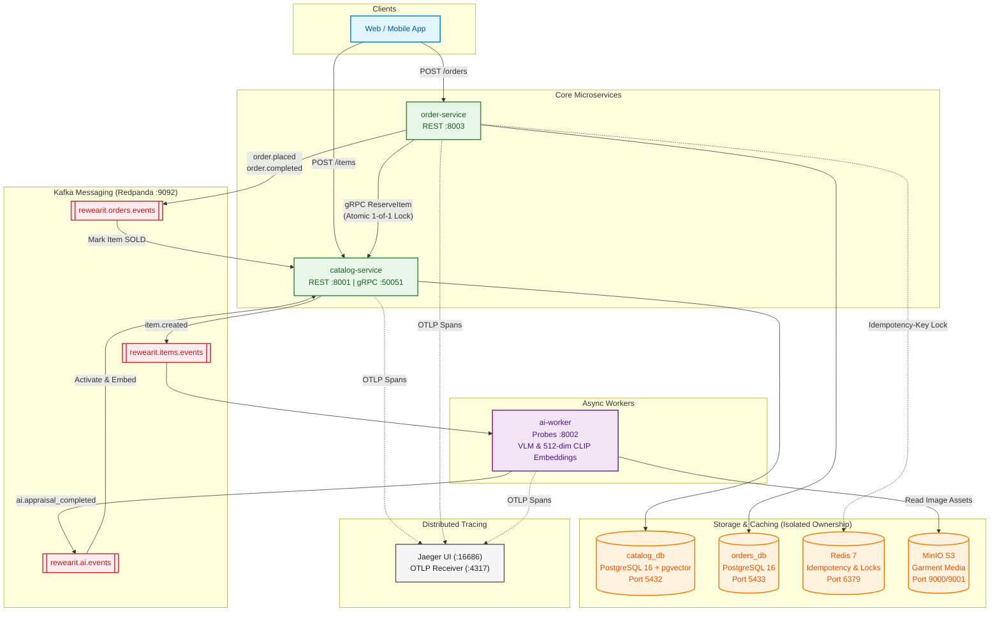
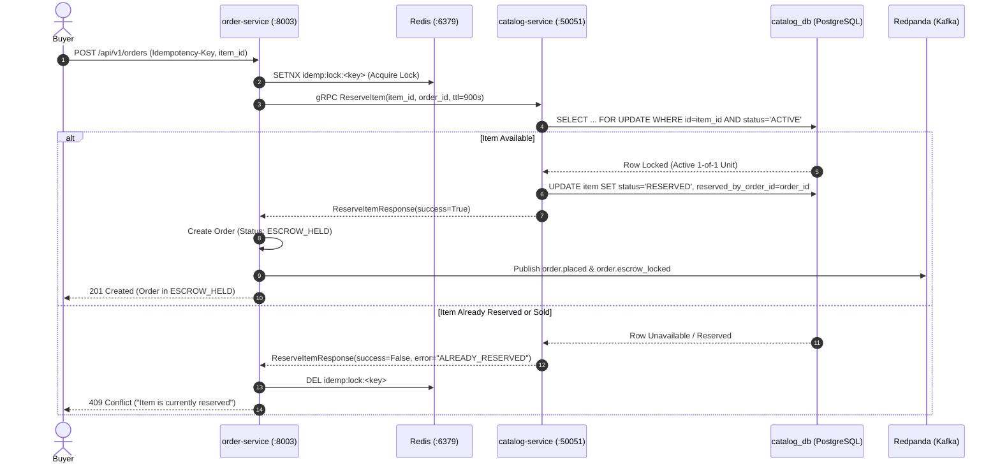

# ReWearIt

Event-driven resale apparel commerce platform with multimodal AI appraisal, pgvector visual search, and atomic 1-of-1 garment reservations.

[](https://www.python.org/)
[](deploy/docker-compose/docker-compose.yml)
[](https://redpanda.com/)
[](https://github.com/pgvector/pgvector)
[](https://opentelemetry.io/)

---

## Architecture

ReWearIt is structured as a decoupled monorepo. Microservices communicate synchronously via gRPC for transactional operations and asynchronously over Kafka (Redpanda) for eventual consistency and domain events. Distributed traces are exported via OpenTelemetry to Jaeger.



---

## 1-of-1 Garment Reservation & Escrow Flow

Second-hand garments are strictly unique (1-of-1 units). To prevent double-selling across concurrent checkouts, `order-service` acquires an atomic Redis idempotency lock, executes a synchronous gRPC reservation with row-level locks in `catalog-service`, and locks escrow funds before confirming the order.



---

## Repository Structure

```text
rewearit/
├── contracts/                  # Canonical Protobuf & gRPC definitions
│   ├── catalog_service.proto   # gRPC reservation and visual search schema
│   └── events.proto            # Kafka event envelope and domain payloads
├── deploy/
│   └── docker-compose/         # Full multi-container mesh with healthchecks
│       └── docker-compose.yml
├── docs/                       # Architecture decisions (ADRs) & specs
│   ├── adr/
│   └── architecture/
└── services/                   # Independent microservices
    ├── catalog-service/        # Listings, pgvector visual search, gRPC servicer
    ├── ai-worker/              # Multimodal VLM appraisal & 512-dim visual embeddings
    └── order-service/          # Escrow state machine, Redis idempotency, gRPC client
```

---

## Services & Ports

| Service | Protocol / Port | Purpose |
| :--- | :--- | :--- |
| **`catalog-service`** | REST `:8001`, gRPC `:50051` | Garment catalog, pgvector vector search, gRPC inventory reservations |
| **`ai-worker`** | Health Probes `:8002` | Asynchronous Kafka worker: VLM attribute extraction & CLIP embeddings |
| **`order-service`** | REST `:8003` | Order transactions, Redis idempotency, escrow state machine |
| **`Jaeger UI`** | HTTP `:16686` (OTLP `:4317`) | Distributed tracing across HTTP, gRPC, and Kafka |
| **`Redpanda Console`** | HTTP `:8080` (Kafka `:9092`) | Kafka cluster management and topic inspection UI |
| **`MinIO Console`** | HTTP `:9001` (S3 `:9000`) | S3-compatible object storage for garment media |
| **`PostgreSQL Catalog`** | TCP `:5432` | Database for catalog service with `vector` extension |
| **`PostgreSQL Orders`** | TCP `:5433` | Database for order and escrow transactions |

---

## Quickstart

### Prerequisites
- Docker & Docker Compose v2+
- Python 3.12+ and [`uv`](https://github.com/astral-sh/uv) (for local testing)

### 1. Launch the Cluster
Run the entire platform with a single command:

```bash
docker compose -f deploy/docker-compose/docker-compose.yml up -d --build
```

Verify all containers are healthy:

```bash
docker compose -f deploy/docker-compose/docker-compose.yml ps
```

### 2. End-to-End Workflow Verification

#### Step 1: Create a Listing
```bash
curl -X POST http://localhost:8001/api/v1/items \
  -H "Content-Type: application/json" \
  -d '{
    "seller_id": "11111111-1111-1111-1111-111111111111",
    "title": "Vintage Levi'\''s 501 Denim Jacket",
    "description": "Authentic vintage trucker jacket in light wash denim",
    "category": "Outerwear",
    "brand": "Levi'\''s",
    "size": "L",
    "condition_grade": "EXCELLENT",
    "price_units": 145,
    "status": "ANALYZING",
    "image_urls": ["https://example.com/images/jacket.jpg"]
  }'
```
*The listing is created with status `ANALYZING`. `ai-worker` automatically consumes the event, grades condition, calculates a 512-dim embedding, and activates the listing (`ACTIVE`).*

#### Step 2: Checkout with Atomic Reservation
```bash
curl -X POST http://localhost:8003/api/v1/orders \
  -H "Content-Type: application/json" \
  -H "Idempotency-Key: order-run-001" \
  -d '{
    "item_id": "<ITEM_ID_FROM_STEP_1>",
    "seller_id": "11111111-1111-1111-1111-111111111111",
    "buyer_id": "22222222-2222-2222-2222-222222222222",
    "total_amount_units": 145,
    "currency": "USD"
  }'
```
*`order-service` invokes `catalog-service` via gRPC `ReserveItem`. The garment status becomes `RESERVED` and the order moves to `ESCROW_HELD`.*

#### Step 3: Complete Order & Release Escrow
```bash
curl -X POST http://localhost:8003/api/v1/orders/<ORDER_ID_FROM_STEP_2>/complete
```
*Order transitions to `COMPLETED`. An `order.completed` event is broadcast on Kafka, and `catalog-service` marks the garment as `SOLD`.*

---

## Observability

- **Distributed Traces (Jaeger):** Open [`http://localhost:16686`](http://localhost:16686) in your browser. Inspect end-to-end spans connecting HTTP requests, gRPC reservations, Kafka events, and database transactions.
- **Kafka Topics & Messages:** Open [`http://localhost:8080`](http://localhost:8080) for the Redpanda UI.

---

## Running Unit & Integration Tests

Each service contains isolated pytest suites:

```bash
# Catalog Service
cd services/catalog-service && uv run pytest

# AI Worker
cd services/ai-worker && uv run pytest

# Order Service
cd services/order-service && uv run pytest
```

---

## License
MIT
