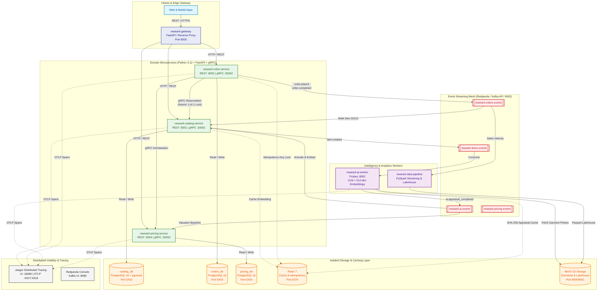
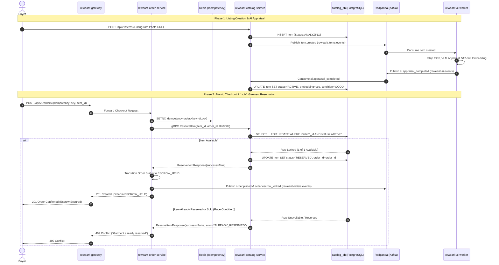

# ReWearIt: Distributed Resale Commerce & Intelligence Platform

> **Central Architecture, Contract Orchestrator & Knowledge Base**

[](./docs/architecture/system-overview.md)
[](./docs/adr/0002-pure-python-stack.md)
[](./docs/architecture/event-schemas.md)
[](./docs/architecture/data-streaming-pipeline.md)
[](./docs/architecture/ai-multimodal-pipeline.md)
[](./docs/architecture/infrastructure-and-k8s.md)

---

## 📖 Overview

**ReWearIt** is an enterprise-grade distributed platform designed to solve the high-throughput, asymmetric data challenges of second-hand apparel marketplaces (inspired by platforms like Vinted, StockX, and Depop).

Rather than a simple monolithic storefront, ReWearIt is built as a suite of decoupled, domain-driven microservices connected via Kafka event streams, powered by an asynchronous multimodal AI appraisal engine, and backed by a PySpark big data analytics pipeline.

This repository serves as the **central architecture orchestrator, schema repository, and living knowledge base** for the entire ReWearIt ecosystem.

---

## 🏛️ System Architecture Topology



---

## ⚡ 1-of-1 Secondhand Garment Reservation & Escrow Flow



---

## 📚 Knowledge Base & Design Docs

- **[Master System Design Specification](./docs/superpowers/specs/2026-10-17-rewearit-platform-design.md)**: Exhaustive technical blueprint covering intent, goals, constraints, domain models, and execution boundaries.
- **[System Architecture & C4 Topology](./docs/architecture/system-overview.md)**: High-level architectural context and container models.
- **[Service Boundaries & Contracts](./docs/architecture/service-boundaries.md)**: Microservice APIs, database schemas, and domain responsibilities.
- **[Event Streaming & Kafka Contracts](./docs/architecture/event-schemas.md)**: Topic partitioning, consumer groups, and idempotency guarantees.
- **[Protobuf Event Schemas (`events.proto`)](./docs/schemas/events.proto)**: Canonical message envelope and payload definitions.
- **[AI Multimodal Pipeline](./docs/architecture/ai-multimodal-pipeline.md)**: VLM image analysis, condition grading, and pgvector similarity search.
- **[Big Data & Streaming Pipeline](./docs/architecture/data-streaming-pipeline.md)**: PySpark streaming windows and daily market depreciation batch models.
- **[Infrastructure & Kubernetes Blueprint](./docs/architecture/infrastructure-and-k8s.md)**: Docker multi-stage builds, Helm charts, and AWS EKS topology.
- **[AI Agent Development Directives (`AGENTS.md`)](./docs/agent-instructions/AGENTS.md)**: Standards, domain rules, and verification checklist for AI coding agents.

### Architecture Decision Records (ADRs)
- **[ADR 0001: Polyrepo Strategy with Central Orchestration](./docs/adr/0001-polyrepo-and-central-orchestration.md)**
- **[ADR 0002: 100% Python Unified Stack](./docs/adr/0002-pure-python-stack.md)**
- **[ADR 0003: Event-Driven Architecture with Kafka & Redpanda](./docs/adr/0003-event-driven-messaging-with-kafka.md)**
- **[ADR 0004: Asynchronous Multimodal AI & pgvector Ownership](./docs/adr/0004-multimodal-ai-for-listing-intelligence.md)**
- **[ADR 0005: Kubernetes, ArgoCD GitOps & Local Parity](./docs/adr/0005-kubernetes-and-gitops-deployment.md)**

---

## 🚀 Quickstart: Bootstrapping Local Infrastructure

The platform provides a complete local shared infrastructure mesh via Docker Compose with zero external cloud dependencies:

```bash
# Navigate to docker compose folder
cd deploy/docker-compose

# Spin up Redpanda (Kafka), Redpanda Console, Redis, MinIO (S3), and 3 PostgreSQL DBs
docker compose up -d
```

### Local Services & Dashboards
| Service | Local Endpoint | Purpose | Credentials |
| :--- | :--- | :--- | :--- |
| **Redpanda Console** | `http://localhost:8080` | Kafka Topic & Consumer UI | None |
| **MinIO Console** | `http://localhost:9001` | S3 Object Storage UI | `minioadmin` / `minioadminpassword` |
| **Kafka Broker** | `localhost:9092` | Event Ingestion & Streaming | None |
| **Redis** | `localhost:6379` | Caching & Idempotency Locks | None |
| **PostgreSQL Catalog** | `localhost:5432` | Inventory & `pgvector` store | `catalog_user` / `catalog_password` |
| **PostgreSQL Orders** | `localhost:5433` | Order State & Escrow | `orders_user` / `orders_password` |
| **PostgreSQL Pricing** | `localhost:5434` | Valuation Curves | `pricing_user` / `pricing_password` |

---

## 📦 Sibling Microservices Repositories

| Repository | Tech Stack | Description |
| :--- | :--- | :--- |
| **`rewearit`** | Markdown, Proto, Helm, Compose | *You are here.* Central architecture & orchestrator. |
| **`rewearit-gateway`** | FastAPI, Redis, Docker | Edge API gateway, JWT auth, rate limiting. |
| **`rewearit-catalog-service`** | FastAPI, gRPC, PostgreSQL, pgvector | Inventory listings, visual similarity search. |
| **`rewearit-order-service`** | FastAPI, gRPC, PostgreSQL, Redis | Escrow state machine, order idempotency. |
| **`rewearit-pricing-service`** | FastAPI, gRPC, PostgreSQL, Redis | Real-time fair market value calculation. |
| **`rewearit-ai-worker`** | Python, VLM SDKs, Kafka, S3 | Multimodal clothing categorization & condition grading. |
| **`rewearit-data-pipeline`** | PySpark, Kafka, Parquet, DuckDB | Clickstream streaming & market analytics batch jobs. |
